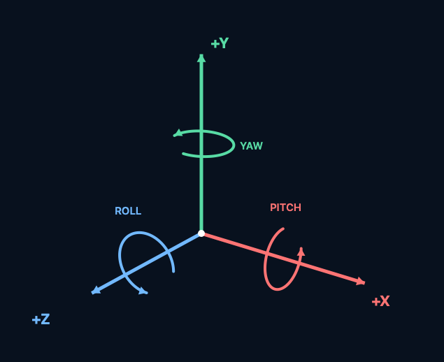

+++
date = '2026-10-24T10:15:00-05:00'
draft = false
title = 'Drawing 3D Primitives'
slug = 'drawing-3d-primitives'
tags = ['BeginMode3D', 'EndMode3D', 'DrawCube', 'DrawSphere', 'DrawCylinder', 'Camera3D']
+++

Working through an example to draw 3D cube, sphere, and cylinder, and how to use a camera object to view them.

# Coordinate System

Raylib uses a right-handed Cartesian coordinate system for its 3D space, where the default axes correspond to:
* +X axis: Points to the right
* +Y axis: Points up
* +Z axis: Points out of the screen toward the viewer (forward/backward depth depends on camera setup, with positive Z coming toward you)

# Drawing the Primitives

**NOTE**: there is a [similar example](https://github.com/raylib-cs/raylib-cs/blob/main/Examples/Models/OrthographicProjection.cs) in the raylib-cs docs.

Actually drawing the primitives is easy.

```c#
// Let's draw in 3D!
Raylib.BeginMode3D(camera);

Raylib.DrawPlane(new Vector3(0.0f, 0.0f, 0.0f), new Vector2(20.0f, 20.0f), Color.LightGray);

Raylib.DrawSphere(new Vector3(-3.0f, 1.0f, 0.0f), 1.0f, Color.Blue);

Raylib.DrawCylinder(
    new Vector3(0.0f, 0.0f, 0.0f),
    1.0f,  // top radius
    1.0f,  // bottom radius
    2.0f,  // height
    16,    // slices
    Color.Green);

Raylib.DrawCube(new Vector3(3.0f, 1.0f, 0.0f), 2.0f, 2.0f, 2.0f, Color.Red);

// Done drawing in 3D
Raylib.EndMode3D();
```

There were only two things that tripped me up:
1. I didn't realize the the cylinder position was on the bottom
2. At first, I didn't realize I needed to call `EndMode3D`, which resulted in a RLGL matrix-stack overflow.


# Setting up the Camera

Setting up the camera was also pretty easy:

```c#
camera = new()
{
    Position = new Vector3(6.0f, 6.0f, 6.0f),
    Target = new Vector3(0.0f, 0.0f, 0.0f),
    Up = new Vector3(0.0f, 1.0f, 0.0f),
    FovY = 45.0f,
    Projection = CameraProjection.Perspective
};
```

With orthographic projection, camera distance doesn’t change apparent size; FovY sets the vertical view span.
Position still determines the viewpoint and framing.

For reference, I put together a little diagram showing the coordinate system.




# Moving the Camera

Moving the camera turned out to be the hard part, at least for me.
To simply "move", the `Position` and `Target` need to change by the same amount.
Changing `Position` while keeping `Target` fixed changes the camera’s view direction; it’s orbiting when you move around the target.

The other surprise was that movement needs to be relative to the camera orientation.
This means doing some vector math based on the camera settings, so that movement aligns with the camera.

I've created a [FlyingCamera](https://github.com/dswisher/3d-playground/blob/c976cdd7c40f5f59ae80bd5998abb73f0dba5fec/src/Playground/Helpers/FlyingCamera.cs) class that handles all of this.
It is probably flawed, but it seems to be working.

